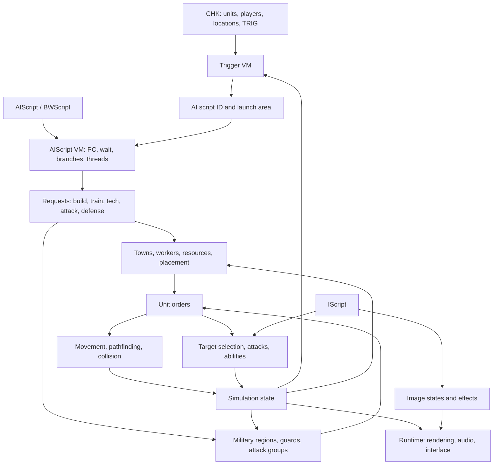

# StarCraft gameplay algorithms for a remake

Research checked on 9 October 2026. The objective is to reproduce the six single-player campaigns of StarCraft and Brood War. The local target is **1.17.0.1**, accepted by the user. Published 1.16.1 reverse engineering remains a separate reference profile; its function addresses and observed mechanics cannot silently become 1.17 evidence.

The remake needs four connected systems: mission data, script interpreters, gameplay simulation, and the built-in AI. The native AI executor was the largest unresolved area; the function atlas now specifies it completely (packages P28–P33, P37–P39). Script programs specify construction and attacks, but separate algorithms service those requests through workers, towns, production, regions, guards, and unit orders. An AIScript interpreter alone cannot reproduce campaign opponents.

Research is **complete** at the function level (2026-10-10). The [function atlas](atlas/README.md) specifies every function of the exact 1.17.0.1 executable, every Storm import and the `Local.dll` resource module, and the [completion ledger](completion-ledger.md) closes all 37 domains against it. [DAT schemas](dat-schemas.md), the [resource manifest](evidence/resource-manifest.json) and the [SMK corpus check](evidence/smk-corpus.json) close the data side. Every atlas entry was independently re-checked against the disassembly ([F03](atlas/f03-final-fixes.md) closes the cross-package issues). The complete original game was observed in the [full-game emulator](full-game-emulation.md): all 64 campaign missions run on the original code, and all six campaign chains run through victory to their end. See the ledger gate. The [pause checkpoint](pause-checkpoint.md) records the earlier stopping point.

## Findings from the local original

The supplied installer was inspected and extracted with `innoextract`; it was not executed. The complete game was not launched natively or under Wine; it runs only inside the Unicorn [full-game emulator](full-game-emulation.md). Earlier, after explicit user authorization, selected original functions were executed in private Unicorn x86 memory, with bounded instruction allowlists and no helper stubs, Windows APIs, host file access, or networking. Extracted original binaries remain in scratch outside the project; the project contains research, hashes, selected disassembly witnesses, and diagnostic scripts.

The third column records the boundary of each executed batch at the time it ran. The [function atlas](atlas/index.md) closes those boundaries statically for the whole executable; the executed results stay authoritative on their recorded inputs.

| Object | Finding | Evidence boundary |
|---|---|---|
| `StarCraft.exe` | PE32 x86; version string `1.17.0`; numerical version `1.17.0.1`; SHA-256 `94dea44898a3934cdfae2a8149c0044db8ad1af4b4bc54306cdca3b1612d6ed0` | Identifies this executable, without proving that the entire repack is unchanged retail data |
| Archives | Five MPQs read; effective DAT/AI/IScript provenance recorded | Applies to this exact archive set and resolver |
| Campaign catalog | 65 mapdata records: `null` and 64 paths | Includes internal variants; does not mean 64 sequential player missions |
| Catalog maps | 31 SC resources including the Terran tutorial, 33 BW resources; 1,869 TRIG and 64 MBRF records | Static records, not observed execution |
| Catalog AI launches | 612 raw launch actions, 173 distinct script IDs | Includes disabled actions and potentially impossible conditions |
| AIScript directory | 293 entries: 137 with code, 156 BWScript redirects | Directory and code decoding, not complete VM semantics |
| BWScript directory | 156 entries | Shares opcode encoding but has a different directory layout |
| Campaign AI closure | 64 opcode types in conservative control-flow traversal | Upper estimate over branches/calls/spawns, not a runtime trace |
| Additional CHK | Four resources outside the catalog, all `VER=57`; 68 CHK found in total | Separate legacy inventory; not established campaign progression |
| Native AI 1.17 | All 113 opcode wrappers reviewed; BIN loading/pool/list, counting, rosters, state setters and selected waits executed | Consuming gameplay helpers remain partly unresolved |
| Native RNG 1.17 | Two functions establish the 32-bit LCG and range scaling | Arithmetic established; full call ordering remains unknown |
| Native frame | AI runs each object step; native post-decrement periods and object/trigger relative order recovered | Inner unit/bullet/image phases remain broader work |
| Native economy | Town request packing, demand percentages, heap priority/ties/full behavior and unit limits recovered and probed | Whole placement/production loop remains incomplete |
| Native workers | Region lookup, worker pool/migration, repair selection and construction gates recovered and probed | Selection prefixes stop before order issue; complete placement and harvesting remain incomplete |
| Native placement | Connected ordinary/creep/Nydus/power/gas validation, depot spacing, reachability, occupancy and original GRP-derived power mask recovered | Terrain/index/list producers, grid search and consuming construction orders remain separate |
| Native AI placement | Base windows, connected filter pipeline, rollback, addon/defense patterns, stock addon geometry, nearest-disabled Pylon recenter and anchor choice recovered | Generated world state, positive anchor production and construction orders remain separate |
| Native region paths | Complete long paths/heap bounds/ties/fallbacks, connected placement distances, hostile selection and single-cut selection recovered | Authentic terrain/adjacency generation, local paths/movement and allocator-backed positive repeated cuts remain separate |
| Native region generation | VF4 walk/megatile flags, complete rectangle graph builder, ordered adjacency/groups/splits/ranks and paths on generated graphs recovered | Allocation-dependent stages are labeled fragments; authentic map import, contours, dynamic terrain and broader boundaries remain separate |
| Original terrain assets | All40 CV5/VX4/VR4/VF4/WPE resources decoded and references across1,045,504 cells in68 CHKs validated | Static/derived asset evidence; original rendering, dynamic terrain and authentic generated graphs remain separate |
| Native terrain import | Complete MTXM/CV5 import on all68 CHKs, original megatile flags for all33,433 VF4 records, and pixel elevation/alternate-tile rules recovered | Allocator-dependent flag/class stages are fragments; native loader defaults, alternate-array producers, contours and complete authentic graphs remain separate |
| Native authentic map regions | Complete graph builder and272 original paths execute on all68 hash-verified MTXM/CV5/VF4 map inputs; ordered output hashes retained | Input allocation stages are fragments; full mission setup, contours, dynamic terrain, local paths and movement remain separate |
| Native contour geometry/growth | All68 authentic contours and30 synthetic inputs match complete records/walk mutation; native signed sorting and growth clear/copy/publication execute | Geometry/growth are explicit allocator-dependent fragments; local movement and dynamic terrain remain separate |
| Native footprint fit | Complete stock/rectangle consumers execute on all68 authenticated contour/terrain inputs with original point gates and signed extents | Full terrain setup, dynamic changes, unit avoidance and local paths remain separate |
| Native terrain sweep/cache | Complete selected movement sweep and safe-area rebuild/hit consumers recovered, including native vertical/horizontal corner-policy difference | Synthetic contour/unit inputs; broad cache invalidation, authentic movement and full FSM remain separate |
| Native triggers/campaigns | Condition/action dispatch, timing, owners, selected actions and native campaign table/branches recovered | Full action/briefing helper semantics remain broader work |
| Native map overrides | Original planar availability/upgrade tables, selected stats/weapon normalization and expansion gates recovered | Most override probes are explicit post-import fragments; DAT defaults and unit creation remain separate |
| Native production requirements | Original unit recipes, lazy offsets, token branches, errors and caps executed | Final production consumers remain separate |
| Native general DAT requirements | Order, research, upgrade and tech-use tables/wrappers, level markers and selected exceptional branches executed | Unit-state dependencies and command consumers remain separate |
| Native training | Stock payment, supply/budget/demand widths, circular queue metadata and ordinary request consumers executed | Special AI transfer, retry and production completion remain separate |
| Native Train lifecycle | Disable/supply/retry gates, HP/shield/timer arithmetic, creation pool failures, cancellation slots, rally and selected worker/guard AI assignment recovered | Successful graphics/unit creation, normal hidden completion, military arrival and actual incomplete-child removal remain separate |
| Native image initialization | Successful stock creation with populated main/shadow IScript, real turret LO, RNG ordering, pool failure/rollback and connected Train allocation recovered | Pixel rendering/resource loading, building/special profiles, populated completion and pending CUnit recycling remain separate |
| Native populated lifecycle | Actual ordinary child creation through full Train timer, populated Show/AI/rally, hidden image progression and deferred CUnit return/reuse recovered | Full accepted-frame schedule, visible Death and building/morph/special profiles remain separate |
| Native hidden-unit completion | Stock Train placement, relocation, Show, spatial/list insertion, generated vision, Observer cloak, density and cancellation Death issuance recovered | Successful allocation/populated images, later Death recycling and additional world-state profiles remain separate |
| Native morph/pair selection | All four parent/pair selectors executed, including list priority and energy-order anomalies | Selection alone does not execute morph/merge orders |
| Native scalar triggers | Resource/score/death/kill queries, setters, player selectors and all decoded campaign parameter tuples executed | Live mission state, counter producers and complete trigger effects remain separate |
| Native trigger ranking | Opponents coalition and six most/least scalar predicates executed | These seven condition types have zero occurrences in the 68-map audit; probes use synthetic state |
| Native trigger unit counts | Command/Bring/MostAt/LeastAt, cache transitions, cargo, elevation and all 1,388 decoded records covered | Count producers, cargo lifecycle and complete mission execution remain separate |
| Native trigger unit actions | Pending outcomes, sequential alliances, timer/order/retirement actions, selected Kill/Remove and Create failure chains recovered across all decoded campaign parameter tuples | Accepted Move/Give, visible destruction, positive creation, UI and progression remain separate |
| Native trigger Move | Ordinary/flying/floating-unit relocation, placement rollback, quantity charging, references, indexes, vision and order resumption recovered | Grounded buildings, positive AI/child/path links and broader mission state remain separate |
| Native grounded Move | Selected Terran/Protoss relocation, stock228-row physical validator, occupancy, bounds/alignments and authored parameter cases recovered | Positive Zerg creep, AI/child/path links, construction and addon cancellation remain separate |
| Native populated Move | Actual stock main/shadow animation resume, queued-order activation and Walking speed/velocity consumers recovered | Positive AI/path/children and broader movement remain separate |
| Native trigger ownership | Ordinary Give transfer, actual list/count/supply/order effects, research/upgrade copying and stale cache behavior recovered | Linked children/addons/powerups, positive AI transfer, real iscript speed and campaign scheduler sequences remain separate |
| Native UNIT properties | HP/shield/energy/invincibility normalization and all 324 campaign start locations executed | Property fixtures use inert units; creation, positive hangar counts and audiovisual state remain separate |
| Native combat AI | Target-rank contradiction, computer Scourge ordering, range upgrades and selected predicates probed | All spell/region decisions remain incomplete |
| Native unit AI | Dynamic strength/cargo and all 188 order-dispatch routes inspected; selected Guard/AttackUnit transitions probed | Dispatch prefixes do not close every order FSM |
| Native military decisions | Guard recall, follower cohesion, group waiting and original Stim eligibility probed | Strategic region transitions, arbitrary connectivity, order issue and Stim application remain separate |
| Native campaign attack preparation | Region-state mutation, actual classification/staging selection and connected prepare/do/clear opcodes recovered | Actual state8/9 progression, military transfer, multiple candidates and complete wave execution remain separate |
| Native campaign wave launch | Actual state8/9 readiness/timeout, military transfer/arrival/dispersion and subsequent attack_do/clear recovered | Positive targeting, periodic recruitment, transport, broader strategic states and physical movement remain separate |
| Native strategic targeting | Positive threat/life scores, regional filtering/first ties, real spatial consumers and global building-tier/distance selection recovered | Upstream strength, military order consumers, retarget/transfer composition and physical attacks remain separate |
| Native attack consumers | Actual positive regional target-to-ComputerAI order issue and state8 global retarget-to-state9 transfer/arrival recovered | Attack execution, initial recruitment, strength production and other strategic branches remain separate |
| Native regional enemy strength | Complete rebuild clears all computer-player region totals and adds actual hostile-unit cached strength with flight buckets and u16 wrap | Unit-strength cache producers, player-step lifecycle and recruitment remain separate |
| Native initial campaign recruitment | Actual state8 roster sweep, guard/military donor adoption and production fallback recovered, including allocation-failure partial mutations | Multi-donor/threat/garrison profiles, other recipe states and outer player lifecycle remain separate |
| Native radius recruitment/sweep | Positive spatial guard conversion, sequential pool exhaustion and333-slot scheduler/cursor/threat timing recovered | Other strategic states, melee planner and physical movement/combat remain separate |
| Native AI route policy | Military cached flood and strategic retained-route filtering recovered; the ground donor ignores the strategic helper's zero return | Authenticated-map policy compositions, multi-donor ranking and physical movement remain separate |
| Native donor ranking | Actual multi-candidate ties/priority/distance, protected source/target states and ignored-route-return adoption/arrival recovered | Other strategic states, production recipes and physical movement remain separate |
| Native damage | Matrix/shield/armor/size/HP pipeline, selected attribution and bullet/melee producers executed | Lethal order/removal, computer reactions and allocated image effects remain separate |
| Native research/upgrades | Starts, payment/progress bits, waiting decisions, level/research writers and refunds executed | Completion effects, primary issue and complete producer order lifecycle remain separate |
| Native spending dispatch | All nine spending kinds, recursive retries, selected Observer/Nuke services and opportunistic-generation gates executed | Complete addon/morph consumers and production progression remain separate |
| Native default production | All seven producer lists, ordered alternatives, explicit/guard redirection, demand/parent insertion and a connected chooser-to-queue path executed | Successful guard adoption and complete training/morph progression remain separate |
| Native guard lifecycle | Shared 1,000-record pool, creation/reset/attach/detach, exact rebuild deadlines and explicit training-word writer recovered | Complete AI cleanup and producer lifecycle remain separate |
| Native guard transfer | Nearest military selection, actual release and complete Zergling/Scourge guard adoption through stock primary-order activation recovered | Killed-unit/state8 removal and other AI membership lifecycles remain separate |
| Native AI removal | Killed-unit region transitions, state8 roster tombstones, Medic replacement, worker/building release and complete selected town migration/deletion recovered | Higher destruction callers/list ordering and additional transplanted-building variants remain separate |
| Native military arrival | Complete selected completed-unit MilitaryAI assignment, real primary activation, source56 destination RNG/table geometry and campaign slowest-unit selection recovered | Positive Tank targets, nonnull garrison release, general connectivity and subsequent strategic waves remain separate |
| Native primary orders | Queue allocation/release, interruption, head activation, AI burrow rules and subunit mapping executed with stock and synthetic order flags | Animation, local error UI and individual consuming order state machines remain separate |

Evidence: [archive and CHK manifest](evidence/retail-manifest.json), [AI inventory](evidence/ai-inventory.json), [PE preflight](evidence/executable-preflight.json), [native AI witnesses](evidence/native-ai-static.json), [RNG witnesses](evidence/prng-static.json). See [reproduction](reproduction.md) for the diagnostic workflow.

Latest extensions: [native contour geometry and buffer growth](native-contours.md), [grounded-building Move](native-trigger-grounded-move.md), [initial campaign recruitment](native-campaign-recruitment.md), and [radius recruitment/regional sweep](native-radius-recruitment.md).

Terrain consumers: [all-map footprint fitting](native-contour-fit.md) and [movement sweep/safe-area cache](native-terrain-sweep.md). Recruitment ranking and complete blocked-route adoption are extended in [donor selection](native-donor-ranking.md).

[All-map movement queries](native-campaign-terrain-sweep.md) compose native cache rebuild/hit and directional sweeps with authenticated full contour arrays and816 valid stock source footprints.

[Movement map bounds and unit collision](native-movement-collision.md) recover stock edge tests, pair policy, actual swept candidates/duplicates and the first eligible blocker. [Observer/transport support requests](native-ai-support.md) connect the periodic AI tail to actual queue admission, payment and selected completed-child assignment.

[Regional states0..7](native-region-states.md) extend the original AI dispatcher through reserve/support/threat/defense transitions and actual transfers. [Populated unit Death](native-unit-death.md) follows stock images, turrets, corpses and pending pools with explicit frame-order boundaries.

[Regional defense recipes](native-defense-recipes.md) recover borrowing/production selection, base-type strength credit, sentinel999 and native scanning across a filled recipe's array boundary.

[Creep geometry/pools and Zerg Move](native-trigger-creep.md) recover positive old-area retention/removal, native border tables and finite1024-node behavior; new-area stamping stops at the explicit CRT thread-context import boundary.

[Active-unit ordering and gameplay IScript](native-active-iscript.md) connect populated stock objects to complete object steps, phase-dependent Death timing, regeneration and actual Zealot melee damage. [Move path/AI/turret links](native-trigger-move-links.md) recover disposal before placement rollback and the actual destination guards after relocation.

[Path storage and waypoint reuse](native-path-storage.md) recover the finite128-byte record policy, packed point/region truncation, restoration, retry timing and waypoint acceptance. Full local path search and walking remain separate.

[Reaction spell permission and issuance](native-reaction-spells.md) establish all stock weapon-target flags, actual technology-target/readiness helpers, selected full caster decisions and cross-caster shared-score effects. Real reservation can succeed even when the order pool is empty.

[Image geometry and ordering](native-image-geometry.md) establish stock GRP frame bounds, ordinary/shield LO distinctions, frame/direction mirroring, image layers and nonempty sprite rows. The original depth key includes a Sprite index tie component.

[Complete selected local routes](native-local-paths.md) connect long-region search, stock-dimension obstacle detours, native local search, packed point consumption and segment continuation with a single finite record. Sprite advances between consumer calls are explicit fixtures.

[Positive reaction spell families](native-spell-families.md) connect all ordinary caster families through real target reservation and order issuance, including Nuke timing, Recall regional permission, existing Dark Swarm overlap and campaign Queen RNG selection. Cast effects and energy debit remain downstream work.

[Indexed GRP blitters](native-pixel-blitters.md) establish normal/mirrored RLE, supplied clipping, player/selection overrides, shift and source/background lookup arithmetic with guarded buffers. Native indexed writes are measured separately from full-screen RGB observations.

[Ranged projectile lifecycle](native-projectiles.md) connects stock Marine/Wraith/Goliath attack IScript to actual populated Bullet allocation, movement, impact, damage and recycling. The finite pool and shared Halo Rockets limit have distinct failure contracts; main attack-order decisions remain separate.

[Local heap identity](native-local-heaps.md) establishes exact pointer ordering through insertion, signed priority changes and sift-down. Equal-cost insertion rises above parents; sift-down keeps an equal parent and chooses the left tied child.

[Selected consuming spell orders](native-spell-effects.md) establish Matrix debit/application/expiry, Irradiate impact/final-tick damage/cleanup, EMP area clearing, Recall debit/wait and the generic completion signal. Successful field creation, Recall relocation and populated overlays remain separate.

[All-map local search](native-campaign-local-paths.md) executes first local segments on all68 original graph/contour profiles, retaining failed searches, bottom-row discrepancies and a real250-node arena case. Endpoint fitting and graph connectivity do not guarantee a complete local route.

[Positive CUnit blockers](native-path-blockers.md) establish actual unit enumeration, path policy and local contour detours with stock mover/blocker bounds. The path-specific stationary/shared-target/shared-mode gates remain distinct from physical pair collision.

[Draw effects and palette state](native-pixel-effects.md) establish cloak/decloak thresholds, in-place displacement, WarpIn texture/callback/signal and selected palette-cycle memory rules. The four positive upload-bound scheduler cases remain explicitly labeled prefixes; RGB submission is separate.

[Main AttackUnit and combat timers](native-attack-orders.md) connect native acquisition normalization, target selection, range/chase, cooldown/jitter and populated ranged damage through48-step original object callbacks. Exact periodic spell cadence and positive Hallucination cache production are distinct.

[Waypoint production and movement17](native-path-progress.md) connect packed-path reuse, local search, finite-record publication and state15/18/25 transitions. Collision-enabled pool failure and the direct branch's success-with-null-path have different contracts.

[Populated spell fields and Recall](native-spell-fields.md) connect original Dark Swarm delivery/lifetime/recycling and Recall issuance/debit/timing/positive relocation/effect expiry. Actual fit order, competing candidates, target clearing and failed-placement rollback are measured; fresh InitArbiter admission remains separate.

[Health bars and selected images](native-health-bars.md) establish exact HP/shield/energy/timed-life arithmetic, clipping, virtual image configuration and original selected-image pool/list consumers. Native detected-owner rows and stock size outlines are measured independently of visible RGB output.

[Complete selected movement](native-movement-fsm.md) follows native-created Marine, Zealot and Wraith through actual acceleration, turning, position/index publication, waypoint release and settled arrival. Three real Move orders also compose original object callbacks and Guard-to-PlayerGuard progression; blocked physical travel remains separate.

[All-tileset palettes and RGB math](native-palette-bootstrap.md) recover the eight definition pointers, stock cycle ranges, actual SSE gamma and grayscale byte rules. Complete buffer consumers and 45 explicit prefixes before device/time-dependent boundaries remain distinct from visible presentation.

[Computer combat and main order families](native-computer-combat.md) connect genuine guard/military allocation to attack support, Stim and stock damage, then cover selected AttackMove/Hold queues and suicide effects. These selected consumers preserve their distinction from full moving-world scheduling and reclamation.

[Natural spell casting](native-spell-casting.md) follows original InitArbiter readiness, regenerated energy, Defiler119 cast bytecode/projectile/field and Recall relocation. A genuine Dark Swarm prevents ground ranged damage and its actual expiry removes that protection.

[Physical obstruction and sliding](native-blocked-movement.md) connect naturally maintained blocker indices to real half/quarter trials, repath, turn and slide responses. Native published positions stay clear, while two short diagonal continuous corner crossings remain recorded original behavior.

[Populated status effects](native-status-effects.md) follow Plague, Ensnare, Stasis and Acid Spores through original applications, overlays, exact periodic services and expiry. Natural Defiler144 delivery and fractional Plague HP boundaries are measured separately from full frame timing.

[Native text and glyphs](native-text.md) recover original packet decoding, character advances, byte controls, TBL/STR lookup, wrapping and measurement on genuine original inputs. Complete buffer contracts remain separate from visible UI, locale imports and encrypted effective-font equivalence.

[Effective font equivalence](native-font-decoder.md) establishes that the five encrypted installed fonts decode to the genuine plaintext references plus one trailing NUL. Complete original crypto leaves and five explicit host compositions remain distinct from execution of the full imported decoder wrappers.

[Native Psi Storm](native-storm.md) follows natural High Templar casting into stock projectile damage and recycling. Seven-service attempts and the target's eight-service shared gate explain damage timing and overlapping-field behavior.

The persistent completion objective and all required original-game domains are tracked in the [completion ledger](completion-ledger.md). Current native specifications: [AI opcode contracts](native-ai-opcodes.md), [frame cadence](native-frame.md), [economy](native-economy.md), [production](native-production.md), [unit production requirements](native-requirements.md), [general DAT requirements](native-dat-requirements.md), [training/payment](native-training.md), [morph/pair selection](native-morph-selection.md), [workers and construction](native-workers.md), [placement](native-placement.md), [triggers and campaign progression](native-triggers.md), [scalar triggers](native-trigger-counters.md), [briefings and map loading](native-briefing-loader.md), [map overrides](native-map-overrides.md), [unit properties](native-unit-properties.md), [combat AI](native-combat-ai.md), [unit AI and combat orders](native-unit-ai.md), [military decisions](native-military-ai.md).

Further native contracts: [Opponents/ranking triggers](native-trigger-ranking.md), [damage](native-damage.md), [research/upgrade starts and refunds](native-research-upgrade.md).

The request-to-order boundary is covered by [building AI spending dispatch](native-spending-dispatch.md), [default production and needed guards](native-default-production.md), [guard pool/rebuild lifecycle](native-guard-lifecycle.md), [military selection and guard adoption](native-guard-transfer.md), and [primary-order queues and activation](native-primary-orders.md).

Accepted queues progress through the [Train execution and completion lifecycle](native-training-lifecycle.md), with complete failed-creation returns distinguished from successful creation and hidden-completion prefixes.

The placement consumer is detailed in [AI candidate grids and final selection](native-ai-placement.md), including every pipeline switch, fallback filters and stock addon offsets.

[Region paths and defense anchors](native-region-paths.md) recover the connected distance helper and distinguish capacity returns, nonoptimal heuristic outcomes, group reversal and single-cut selection.

Unit-dependent campaign predicates are detailed in [Command/Bring/location unit counts](native-trigger-unit-counts.md), including native differences from pinned OpenBW.

[Trigger unit actions and outcomes](native-trigger-unit-actions.md) and [AI removal/town migration](native-ai-removal.md) recover their connected consumers with explicit completed-path boundaries.

[Military assignment and arrival](native-military-arrival.md) closes selected successful MilitaryAI allocation/order paths previously recorded as Train prefixes.

## Behavioral dependencies

This is a proposed dependency model, **not the proven original frame processing order**. Identical formulas with different ordering of commands, RNG, impacts, and triggers can produce different behavior.

## Algorithm coverage

| Area | Required mechanisms | Useful sources | Unresolved original 1.17 evidence |
|---|---|---|---|
| Simulation step | Update phases, command queues, timers, stable entity traversal, RNG | OpenBW frame pipeline; native frame/RNG | Inner entity phases, command application and traversal; outer AI/trigger cadence is recovered |
| Units and orders | Current-order FSM, queues, secondary orders, interruption, target invalidation | OpenBW handlers; GPTP orders | Complete campaign-facing order transitions |
| IScript | PC/wait/branches, animation headers, movement, attack and missile damage | OpenBW interpreter; PyMS schema | Gameplay effects, insertion/death ordering, shared RNG consumption |
| Movement | Regions, walk cells, unit dimensions, avoidance, repath, turning, acceleration, worker collision | OpenBW; Patrick Wyatt; GPTP | Tie-breaking, blocked paths, special orders, unreachable destinations |
| Combat | Acquisition, threat/rank, distance, wind-up, projectiles, damage, splash, armor, shields | OpenBW; GPTP; Blizzard damage tables | Conflicting reconstructions, rounding, effect-specific branches |
| Vision | Fog, explored/visible, LOS/elevation, cloak/detection, shared vision | OpenBW and source data | AI knowledge rules, update cadence, geometry boundaries |
| Economy | Resource selection, worker allocation, gathering/return, mineral queues, depleted gas, construction | Harvest/construction handlers; native AI structures | AI economic heuristics and building placement |
| Race mechanics | SCV repair/addons/lift; Drone morph/Larva/creep; Probe warp/power/shields | Orders, DAT, IScript | Cancellation, ownership changes, power/creep boundaries |
| Technology | Requirements, supply, production, tech/upgrades, refunds, availability | DAT plus native requirements/handlers | EXE rules absent from DAT need a separate audit |
| Built-in AI | Script VM, requests, towns, guards, regional strengths, grouping, reaction, spells | PyMS, AISE, Teippi, GPTP, local scripts and dispatch | Source mods change some behavior; original 1.17 thresholds and helpers remain incomplete |
| Campaigns | CHK conditions/actions, waits, preserve, owners/forces, briefings, objectives, progression | PyMS schema; extracted corpus; selected OpenBW handlers | Complete Trigger/Briefing VM, scheduler, campaign glue |
| Saving | Mutable state, AI/VM/queues/timers/RNG, reference restoration and traversal order | Research structures; proposed remake contract | Behavioral continuity across save/load |

Concrete functions, mechanisms, conflicts, and distinguishing experiments are documented in [simulation](simulation.md), [AI](ai.md), and [campaigns](campaigns.md).

## Main AI conclusions

Campaign and melee opponents have different goals. Blizzard's historical FAQ describes campaign AI as relying on a prepared town and resource reserve, rebuilding important structures, and sending authored waves; melee has different development and expansion responses. Replacing campaign AI with a modern general RTS bot would change mission balance. This describes standard AI classes; each mission's exact script and trigger setup must still be inspected. [Blizzard AI FAQ](https://classic.battle.net/scc/faq/aiscripts.shtml).

The VM specifies intent: required buildings, units, technologies, and attack composition. Lower layers decide placement, worker allocation, supply/prerequisites, spending, troop assignment, and target regions. Unit targeting and spell decisions continue below those layers. [Detailed AI findings](ai.md).

[Native 1.17 AI witnesses](native-ai.md) establish several important constraints: `random_jump` compares the low RNG byte with a threshold using `<=`; `call/return` use a single global return PC; blocking handlers set wait=30. A percentage-based random or full call stack would change those mechanisms. Native caller recovery now establishes that this skips 30 following object steps and becomes eligible on the 31st. [Frame cadence](native-frame.md).

**OpenBW is not a complete implementation of original campaign AI.** The pinned source has errors for ComputerAI, AIPatrol, and other AI orders; trigger AI launches support only special cases. Detailed combat simulation does not establish campaign completeness. [OpenBW orders](https://github.com/OpenBW/openbw/blob/4b046d5f65302b10cb0a745f0fecd37ec85b20a8/bwgame.h#L8070-L8120), [AI trigger actions](https://github.com/OpenBW/openbw/blob/4b046d5f65302b10cb0a745f0fecd37ec85b20a8/bwgame.h#L19060-L19110).

**AISE, Teippi, and GPTP mix reconstruction with modifications.** They contain useful native structures and mechanisms alongside fixes, extensions, and calls back into the original EXE. A hook is evidence for a particular mechanism, not a standalone implementation of the whole game. [AISE](https://github.com/neivv/aise/blob/da4fed681dc09bda7a21c0051f60cdad98cc7226/src/aiscript.rs), [Teippi](https://github.com/neivv/teippi/blob/05c006c2f74ad11285c39d37135aed03d1fb8806/src/ai.cpp).

## Implementation implications

Use a native simulation (`kp_core`) with an explicit fixed logical step and state, followed by a rendering/audio/interface adapter. Unit orders, AI, triggers, IScript, and collision belong in simulation. Physics callbacks and independent visual animations must not determine combat outcomes or impact timing.

Integer arithmetic needs care: for seed `0xffffffff`, direct double multiplication in the LCG produces `4272271824`, while exact x86 overflow produces `4272271820`. A custom RNG therefore requires exact multiplication, range scaling, call order, and saved seed. [Native RNG](native-prng.md).

VM state, request queues, towns, and guards should be explicit and serializable; coroutine stacks do not automatically become a save format. Measure HTML5 and iOS separately.

## Next research stages

1. **Finish consuming helpers behind the opcode contracts.** All 113 wrapper contracts are now recorded, including the 64 campaign types. Complete town, placement, production, region, guard and spell algorithms; wrapper coverage is not their completion.
2. **Follow one economy and one wave through a real map.** Trace town creation, building/production requests, waits, and attack preparation all the way to unit orders. Keep the mechanism general rather than encoding the chosen mission.
3. **Recover remaining native 1.17 helpers.** Immediate dispatch cadence, spending heap, demand percentages, and selected target contradictions are closed. Continue placement, complete worker recovery, request servicing, region strength/states, guards and all spell targets. Match 1.16.1 anchors by code and contract rather than address.
4. **Collect controlled observations.** Use minimal maps for blocked production, a killed builder, missing supply, blocked exits, invisible targets, broken attack groups, guard losses, and spell targets. Record events and raw state by frame.
5. **Validate campaign behavior.** Check script launches, waves, technology, reactions to player interference, victory/defeat, and save/load across the catalog. Compare both undisturbed and disrupted economies.

The existing plan's BWAPI observer cannot simply be applied to 1.17: the pinned README requires 1.16.1, while its 1.17 support issue lists changed addresses and loading requirements. Establish a compatible observer for this target or retain a separate 1.16.1 reference environment. [BWAPI setup](https://github.com/bwapi/bwapi/blob/d727fed68558c506163048ea889131d8cbb33915/README.md#L34-L54), [issue 673](https://github.com/bwapi/bwapi/issues/673).

## Completeness

This research maps the required original-game domains, derives the campaign corpus, recovers native 1.17 contracts, and executes selected original functions in isolation. **Complete reconstruction of every required algorithm and remake parity remain unproven.** The [completion ledger](completion-ledger.md) retains the full objective and every unfinished domain. The complete game, a build, and campaign playthroughs have not been executed.

## Sources

- [AI research](ai.md), [simulation research](simulation.md), [campaign research](campaigns.md).
- [Native AI](native-ai.md), [native RNG](native-prng.md).
- [Pinned source versions](evidence/source-manifest.json).
- [Blizzard AI FAQ](https://classic.battle.net/scc/faq/aiscripts.shtml).

[Natural support casts](native-support-casts.md) follow genuine Arbiter, Queen and Science Vessel orders into Stasis, Ensnare, Matrix, Irradiate and EMP, with populated overlays, projectile recycling and periodic cleanup. Irradiate's original damage-before-regeneration ordering and EMP's impact reset remain distinct from later recovery.

[Native weapon effects](native-weapon-effects.md) recover Mutalisk bounce iteration, ground splash boundaries, Firebat's live weapon-table mutation, Lurker's finite hit history and the paid Scarab hangar/launch/damage/recycling chain. The [subunit/Scarab follow-up](native-subunit-scarab.md) establishes automatic body-to-turret commands and complete selected physical pursuit/interruption/reclamation.

[Populated harvesting](native-harvesting.md) follows complete original SCV/Drone/Probe mineral movement, mining and return through the whole-object callback. Separate contracts cover cargo/deposit, depleted gas, waiting queues, computer-worker bonus and Hatchery-family deposit-side weights.

[Natural Hallucination](native-hallucination.md) follows original High Templar casting into genuine copy allocation/placement, owner image state and full selected expiry/Death/recycling. Finite-pool casts still consume the full energy cost; EMP and Matrix remove genuinely created copies through their original consumers.

[Native audiovisual contracts](native-audiovisual.md) recover stock portrait substitutions and separate UI RNG, sound-selection guards, duration arithmetic, RIFF parsing, channel selection and dialog geometry. Independent FFmpeg resource checks are reported separately from original calls/fragments/import prefixes.

[Automatic subunits and physical Scarabs](native-subunit-scarab.md) follow genuine Tank/Goliath body-only commands through turret damage and a paid/trained Scarab through physical pursuit, impact and natural object-callback recycling. Parent Stop before and after Bullet creation has different damage and final-movement contracts.

[Populated gas entry and return](native-gas-harvesting.md) follow original SCV/Drone/Probe approach, hidden service, stock cargo, exit fitting and deposit, including depleted gas and no-depot emergence. The37 timer becomes36 within the same object callback after the newly hidden worker is serviced.

[Native BIN fixups and theme consumers](native-dialog-bin.md) establish authentic statport pointer/SMK/callback relocation, isolated widget behavior, frame selection and declared font/color/theme contracts. Bitmap loading and font-language prefixes remain separate; the unresolved144-byte UI color-bank suffix is not assumed zero.

[Additional native ability casts](native-ability-casts.md) follow natural Yamato, Lockdown, Optical Flare, Parasite, Broodlings and Consume into stock effects and selected cleanup. Genuine Broodlings expire and are reclaimed; failed Broodling allocation still kills and credits the target, while Yamato caster Death before launch cancels damage after energy debit.

[Paid Carriers and native Interceptors](native-carrier.md) establish real capacity recipes, hidden training, physical launch/fire/return, first-damaged repair, shield phase ordering and allocation retry after natural CUnit recycling. Original1.17 uses a quarter-shield return threshold and an elevation increment of2; both differ from the pinned Teippi reconstruction.

[Populated Terran construction](native-construction.md) follows real SCV movement, payment, stock building creation, work points, HP/time/graphics, supply, Stop/resume, builder Death/replacement and early/late cancellation through complete object callbacks. Full graphics precede Completed; both cancellations refund75% regardless of progress.

[Native mission UNIT processing](native-mission-units.md) audits all68 CHKs/21,427records and executes complete selected supported-tutorial mobile creation/property chains, player copies, admission/default orders, failures and trap contracts. The588 complete cases,3 import prefixes and3,422 bounded loop fragments remain distinct.

[Native mobile transports](native-transport.md) follow actual transport-produced passenger boarding, physical unload travel, packed cargo/capacity, pacing, failure, loaded ownership transfer and natural Death/reclamation. Two passengers unload on callbacks1/20 in the selected phase; placement failure retains cargo but changes hidden position and finishes the human command to idle.

[Natural remaining Brood War abilities](native-bw-casts.md) establish Restoration, Web field/ground markers/weapon suppression/expiry, Mind Control with genuine Tank subunits and paid inside/outside Interceptors, Feedback damage/lethal cleanup, and Maelstrom timer/overlay consumption. Natural Dark Archon Init releases its spell lock after17 image services.

[Native Town pools and startup helpers](native-towns.md) execute shared pool initialization/exhaustion/reuse, genuine worker/building attachment and distinct owner-list/area admission and center rules. First-Town allocation failure still removes parentless Guards; spatial area startup can assign a dying or explicitly incomplete worker. [Connected AIScript startup and request-to-completion](native-ai-construction.md) now executes selected Terran chains separately.

[Native campaign-special initialization](native-special-initialization.md) executes genuine Mine13, Scanner Sweep33, Map Revealer101, trap/door/powerup creation, stock default orders, real optional sweep Thingy allocation/failure and generated vision. All173 selected actual UNIT records are covered; THG2/trigger producers and later special orders remain separate.

[Native Bunker boarding and weapons](native-bunker.md) follows physical passenger approach, original hidden target acquisition, stock Bullet delivery, passenger kill credit, the64-pixel range addition, finite muzzle allocation, immediate four-passenger unload, clear/blocked destruction and actual loaded ownership transfer. Twenty-one complete cases are distinct from live computer-AI command production.

[Native doors, traps, powerups and rescue](native-special-orders.md) connects stock allocation to genuine door/trap animation signals and turning, all fifteen worker powerup pickups, controller/timer rescue gates and completed-depot whole-owner-list transfer. Its 105 complete cases preserve the immediate distinction between CUnit ownership and Sprite allegiance; full campaign dispatch and subsequent carried-item consumers remain separate. [Native trap combat](native-trap-combat.md) connects all six trap types to acquisition, stock projectiles/damage, natural Civilian escape, re-hiding and second-target acquisition in20 complete cases.

[Connected AIScript construction](native-ai-construction.md) follows original VM startup, persistent Town request, spending refresh, full worker requirements/placement, deferred stock payment and genuine completed Depot attachment. Twelve complete cases include resource/availability retention, placement-throttle popping and next-pass regeneration.

[Native Nydus lifecycle](native-nydus.md) covers genuine exit creation and stock construction, physical two-way travel, queued/default resumption, rollback, allocation failure, ownership and pair Death/reclamation in21 complete cases. Paid Drone entrance production remains separate.

[Native carried powerups](native-powerup-lifecycle.md) follows all15 pickups through actual carrier relocation, Drop and Show, and the Flag's337-step countdown followed by original-origin return. Its28 complete cases distinguish early re-pickup and invalid-tile fallback from full CTF feedback.

[Native automatic Town requests](native-automatic-requests.md) runs34 complete cases for genuine population supply thresholds and timing flags, pending-queue reservation/duplicate prevention, gas desire/expansion and regional Bunker/Turret requests. One automatic Depot completes through the original object phase without a script `build` request. Resource slots, worker limits and regional flags remain declared inputs.

[Native nuclear missile lifecycle](native-nuke.md) executes paid production, Ghost navigation/channel/launch, stock Bullet delivery, radius/damage boundaries, state5 cancellation commitment and reclamation in30 complete cases. Computer-AI child/return-to-base and campaign command composition remain separate.

[Native resource areas and worker allocation](native-resource-areas.md) runs81 complete cases for periodic totals/occupation, ordered mineral/gas selection, equal-distance replacement, player-wide limits and genuine Town binding/spending-sensitive WorkerAi labels. Original area generation and physical harvesting remain separate producers/consumers.

[Native resource-area generation](native-resource-generation.md) runs42 complete cases for compacted starts, resource tagging/clustering/weights/reference/capacity and three generator-to-Town compositions. Authentic terrain/world initialization remains separate.

[Native Computer AI nuclear scripts](native-ai-nuke.md) runs20 complete selected cases for genuine Town/Guard/Military relationships, authentic NuHe/TB2A consumers, launch/cancellation/Death commitment and return-order issuance. Physical cross-region return on authentic contours and whole-mission scheduling remain separate.

[Native special-object producers](native-special-producers.md) records 33 complete cases, 160 bounded THG2 fragments and one import-boundary prefix, including all actual trap/door source records, special-item Create consumers, stale Command cache behavior and carried-item Death/reappearance.

[Paid Zerg construction](native-zerg-construction.md) records 15 complete cases for original Larva spawning, paid Egg/Drone production, deferred Pool payment, same-slot construction, cancellation and genuine WorkerAI/BuildingAI changes. Positive creep production and complete strategic scheduling remain separate.

[Native mineral-reference ties](native-resource-reference-ties.md) records two complete paired compositions with direct original reference-pointer/score capture. Equal scores replace the reference in active-list order, and changing that order changes the resulting resource-area partition.

[Native carried-object campaign goals](native-powerup-goals.md) records 32 complete cases for duplicate pickup refusal, carried-item destruction/replacement, all three actual special-item Kill/Remove actions and all seven actual portable-object Bring conditions. Full mission trigger scheduling remains separate.

[Original resource-area generation on campaign inputs](native-campaign-resource-areas.md) records 64 complete supported-map compositions with 3,684 actual resource-container UNIT records, authenticated original-generated graphs and native terrain import/height checks. Whole mission startup, nonresource obstructions and Town scheduling remain separate.

[Authentic resource producers connected to Town binding](native-campaign-resource-towns.md) records two complete compositions with actual start/depot/worker/resource records, original resource areas and genuine AIScript Town/WorkerAI/BuildingAI allocation. The synthetic script and runtime-player/regional-AI inputs remain explicit.

[Authentic Protoss Town binding](native-campaign-protoss-towns.md) records two complete Nexus/Probe compositions with native Town/AI pools, start/resource producers and generated area binding on authenticated campaign terrain. Full mission/racial bootstrap and physical harvesting remain separate.

[Connected Ter5 attack waves](native-ai-wave.md) records three complete compositions linking authentic script fragments, native Guard-to-Military recruitment, physical combat, missing-member requests and original elapsed-clock retries. Paid replacement completion and complete mission/frame policy remain separate.

[Carried-worker construction and campaign Bring](native-carried-construction.md) records seven complete cases distinguishing SCV carry retention from Drone Drop/conversion/origin restoration, including cancellation, natural re-pickup and actual campaign Bring predicates. Carried Probe/Extractor variants and whole mission progression remain separate.

[Paid Protoss warp and power lifecycle](native-protoss-construction.md) records 17 complete compositions from paid Probe production through Pylon/Gateway construction, cancellation, finite allocations, Town assignment and genuine psi-source destruction/replacement. Full psi-mask heap bootstrap and remaining racial building variants remain separate.

[Paid completion of a missing campaign roster](native-ai-paid-roster.md) records four complete cases linking genuine Barracks/Academy/Town prerequisites to payment, stock Train, Military wave membership and Guard restoration. Native cancellation, refund and later re-payment of the queued Guard replacement are retained as observed policy; upstream paid buildings and whole mission setup remain separate.

[Natural campaign WorkerAI and repeated physical mining](native-campaign-ai-harvesting.md) records four complete Terran/Protoss compositions with authentic resource/start/depot/worker inputs, native Town binding and 3,025 full object callbacks. No worker order or direct WorkerAI service is supplied by the host; each genuine worker deposits at least twice, with per-callback conservation and index geometry checks. Whole campaign/world/frame startup remains separate.

[Paid Zerg Extractor conversion and cancellation](native-extractor.md) records six complete cases and one explicit completion-stamping prefix: genuine source reuse, finite cancellation failure, item return/re-pickup and resource/placement refusals. The completion prefix stops before the real Windows import and is not reported as a complete callback.

[Paid Assimilator conversion, warp, gas and carried Probe](native-assimilator.md) records 12 complete cases: authentic Geyser identity reuse, three cancel stages, completed Death restoration, finite-pool success and live cost/occupied-source refusals. Physical gas delivery follows an explicit new Harvest command after the builder's incomplete-target WaitForGas rejection; carried-item routes record their genuine Move reissues.

[Native AI paid prerequisite chain and Firebat](native-ai-tech-build.md) records three complete profiles. Natural ComputerAI service selects the SCV, builds and completes Depot/Barracks/Academy, pays/trains a Firebat and attaches MilitaryAI; separate cash and availability failures retain the Academy wait. The macro and one-region world are declared inputs.

[Paid Refinery, physical gas and carried SCV](native-refinery.md) records four complete cases: in-place gas-source conversion under exhausted CUnit storage, normal construction and physical gas delivery, completed Death/source restoration, carried-item completion/cancellation and genuine late-payment refusal. Positive waiting-list or occupied hidden-worker destruction remains separate.

[StarCraft: Remastered as a data source](remastered.md) (2026-10-26, [ADR 0013](../adr/0013-remastered-data-source-and-hd.md)) reads the local CASC install of 1.23.10.13515 with `tools/research/scdata/casc/`: its eleven DAT tables and three script files equal profile 1.17.0.1's byte for byte, its tilesets only append to the original records, and its engine code is encrypted, so engine differences remain unestablished. It also records the HD `.anim` format, the HD terrain (one tile per megatile, checked by image) and the interface's layout data, with the Mini-Map Position option behind `GameConsoleSplitOption`.

[Replays and network play: what the original game shows](replay-network-notes.md) (2026-11-13) collects what the atlas already specifies for replays and lockstep play, the `excluded` network entries a later network design must re-specify, unconfirmed leads to check on the emulator (a command-loss bug of the replay playback, data equality of the two data sources, state left out of saves), and the open design questions.
